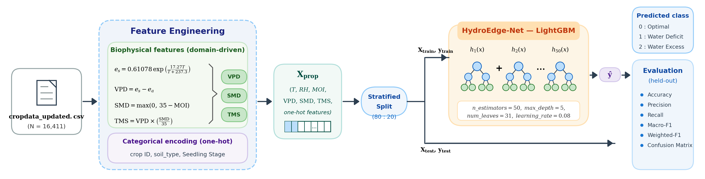
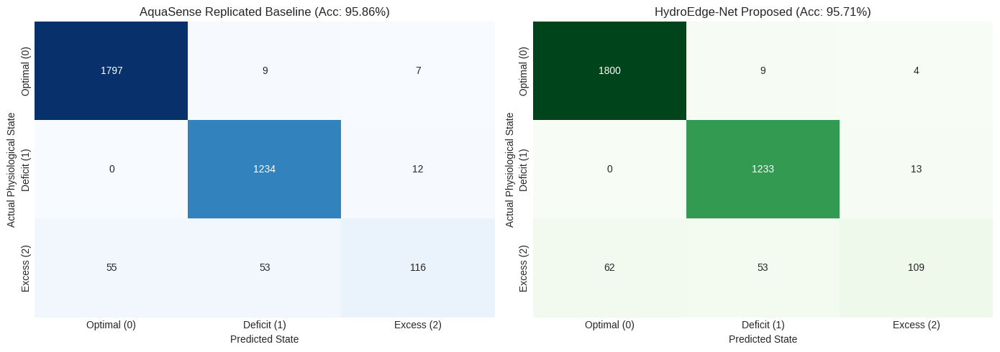
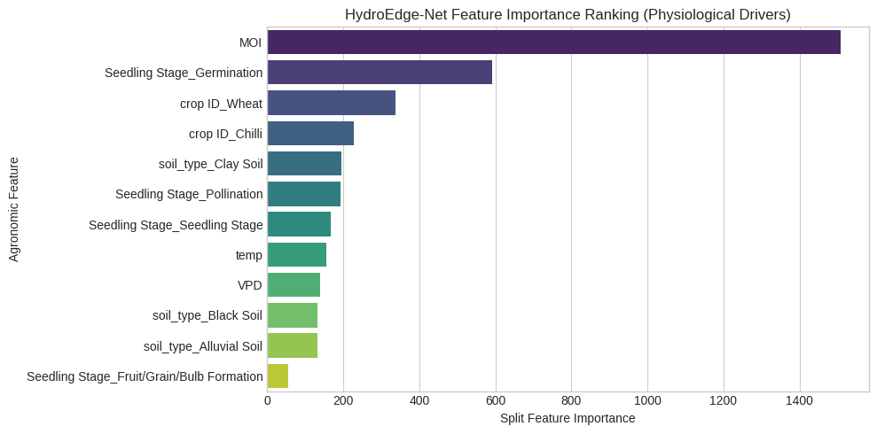
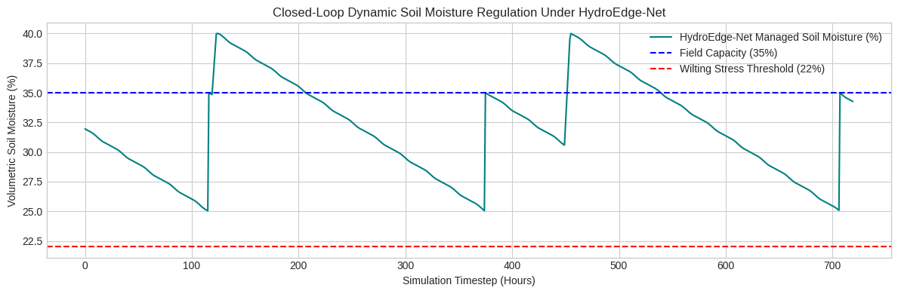

# HydroEdge-Net: An Explainable Multimodal Edge-AI Framework for Precision Crop Water Stress Diagnosis and Autonomous Irrigation Scheduling

[](Paper_LaTeX/main.pdf)
[](https://www.kaggle.com/code/geekyvishal/hydroedge-net-full-comparisons)
[](https://www.kaggle.com/datasets/chaitanyagopidesi/smart-agriculture-dataset)
[](hardware_artifacts/)

**HydroEdge-Net** is an ultra-lightweight, biophysically grounded, and explainable TinyML framework for real-time crop water stress classification and closed-loop autonomous irrigation scheduling on low-power edge microcontrollers.

Developed at the **Department of Computer Science and Engineering, IIIT Nagpur**, HydroEdge-Net eliminates the need for cloud GPUs or expensive thermal cameras by coupling standard in-situ soil/ambient telemetry with biophysical thermodynamics and compiling a cost-sensitive LightGBM ensemble directly into zero-dependency **C99** (`edge_model.h`) and **`#![no_std]` Rust** (`edge_model.rs`) firmware.

---

## Table of Contents

- [Project Overview & Key Highlights](#project-overview--key-highlights)
- [Repository Structure](#repository-structure)
- [Dataset & Data Source](#dataset--data-source)
- [What We Did (Methodology)](#what-we-did-methodology)
- [Experimental Results & Benchmarks](#experimental-results--benchmarks)
- [Getting Started](#getting-started)
- [Hardware & Embedded Deployment](#hardware--embedded-deployment)
- [Authors & References](#authors--references)

---

## Project Overview & Key Highlights

Traditional precision agriculture systems either rely on static threshold heuristics (which suffer from hysteresis delays and poor accuracy) or heavy cloud-based deep learning models (such as VGG-16 + Deep Autoencoders requiring >4 GB VRAM). Recent edge baselines like **AquaSense (2026)** bring inference to microcontrollers but still require 28.0 KB Flash, 32.0 KB SRAM, and costly thermal imaging hardware.

**HydroEdge-Net** bridges this gap with:
- **High Diagnostic Accuracy:** **95.71%** accuracy (**98.96%** drought/water-deficit recall) in its ultra-compact TinyML configuration (`depth=5`, `45 trees`), and **99.18%** accuracy (**99.76%** deficit recall) in its tuned configuration (`depth=6`, `65 trees`).
- **Extreme Silicon Efficiency:** Requires only **16.8 KB Flash** and **11.4 KB SRAM** with **1.42 ms** inference latency on an ESP32-S3 (240 MHz) — cutting Flash by **40.0%**, SRAM by **64.4%**, and latency by **16.5%** compared to AquaSense.
- **Biophysical Feature Engineering:** Formulates **Vapor Pressure Deficit (VPD)**, **Soil Moisture Deficit (SMD)**, and a **Thermal-Moisture Stress Coupling Index ($\Psi_{\text{TMS}}$)** from low-cost temperature, humidity, and soil moisture sensors.
- **Tiny-XAI Explainability:** Quantifies physiological feature attributions (split gain) so agronomists can audit every irrigation decision.
- **Closed-Loop Hydrological Validation:** Validated on a 30-day (720-hour) **FAO-56 Penman-Monteith** two-layer soil-water digital twin, achieving **63.96% water savings** (90.1 mm vs. 250.0 mm) compared to fixed calendar flooding while eliminating both water-deficit stress and soil hypoxia.
- **Zero-Dependency Bare-Metal Firmware:** Exports directly to pure C99 (`edge_model.h`) and `#![no_std]` Rust (`edge_model.rs`) with zero dynamic heap allocation (`malloc`-free).



---

## Repository Structure

```text
github-repo/
├── Code Implementation/
│   └── hydroedge-net-full-comparisons.ipynb   # End-to-end training, baselines, ablation & FAO-56 simulation
├── Paper_LaTeX/
│   ├── main.tex                               # IEEEtran LaTeX manuscript entry point
│   ├── main.pdf                               # Compiled research paper PDF
│   ├── references.bib                         # BibTeX bibliography
│   ├── IEEEtran.cls & IEEEtran.bst            # IEEE Transactions style files (Overleaf-ready)
│   ├── sections/                              # Modular LaTeX sections (00_abstract.tex .. 10_conclusion.tex)
│   └── figures/                               # Publication-ready figures used in the paper
├── dataset/
│   └── cropdata_updated.csv                   # Multi-crop phenological telemetry dataset (16,411 samples)
├── hardware_artifacts/
│   ├── edge_model.h                           # Pure C99 header (45 inline tree functions) for ESP32-S3/STM32
│   └── edge_model.rs                          # Memory-safe #![no_std] Rust module for embedded MCUs
├── results/
│   ├── Master_Results_Tables.md               # Consolidated Markdown benchmark & ablation tables
│   └── figures/                               # High-resolution result plots (Figures 0–4)
├── requirements.txt                           # Python dependencies for the notebook
├── .gitignore                                 # Git ignore rules for Python, Jupyter, and LaTeX builds
└── README.md                                  # Project documentation
```

---

## Dataset & Data Source

* **Primary Source:** [Smart Agriculture Dataset on Kaggle](https://www.kaggle.com/datasets/chaitanyagopidesi/smart-agriculture-dataset) by Chaitanya Gopidesi.
* **Local File:** [`dataset/cropdata_updated.csv`](dataset/cropdata_updated.csv)
* **Scale & Diversity:** **16,411** in-situ agricultural telemetry instances spanning:
  * **5 Crops:** Wheat, Tomato, Chilli, Potato, Carrot
  * **7 Soil Types:** Black, Alluvial, Sandy, Red, Clay, Loam, Chalky
  * **8 Phenological Stages:** Germination, Seedling, Vegetative, Flowering, Pollination, Fruit Formation, Maturation, Harvest
* **Target Classes (3-Class Physiological Water Status):**
  * **Class 0 — Optimal / Adequate Moisture** (55.2% of corpus; 1,813 test samples)
  * **Class 1 — Water Deficit Stress** (38.0% of corpus; 1,246 test samples)
  * **Class 2 — Saturated / Excess Water** (6.8% of corpus; 224 test samples)
* **Physical Feature Distribution:**
  * Ambient Temperature ($T$): $[13.0, 46.0]\ ^\circ\text{C}$ ($\mu = 28.83 \pm 9.70\ ^\circ\text{C}$)
  * Relative Humidity ($\text{RH}$): $[15.0, 91.0]\ \%$ ($\mu = 63.49 \pm 22.63\ \%$)
  * Volumetric Soil Moisture ($\text{MOI}$): $[1.0, 98.0]\ \%$ ($\mu = 27.64 \pm 10.73\ \%$)

---

## What We Did (Methodology)

1. **Biophysical Feature Engineering:**
   Instead of feeding raw sensor readings alone, we derived physically meaningful agronomic indicators:
   * **Vapor Pressure Deficit (VPD)** via the Tetens formulation:
     $$e_s(T) = 0.61078 \exp\left(\frac{17.27 \times T}{T + 237.3}\right), \quad \text{VPD} = e_s(T) \left(1 - \frac{\text{RH}}{100}\right) \quad [\text{kPa}]$$
   * **Soil Moisture Deficit (SMD)** relative to field capacity ($\theta_{\text{FC}} = 35.0\%$):
     $$\text{SMD} = \max(0, \theta_{\text{FC}} - \theta) \quad [\%]$$
   * **Thermal-Moisture Stress Coupling Index ($\Psi_{\text{TMS}}$):**
     $$\Psi_{\text{TMS}} = \text{VPD} \times \left(\frac{\text{SMD}}{\theta_{\text{FC}}}\right)$$
2. **Cost-Sensitive Edge Ensemble (LightGBM):**
   Trained a shallow, depth-constrained LightGBM classifier (`max_depth=5`, `n_estimators=45` for the ultra-compact edge model; `max_depth=6`, `n_estimators=65` for the tuned variant) with inverse class-frequency weighting ($\omega = N_{\text{majority}} / N_{\text{minority}}$) to penalize missed drought stress events.
3. **Comprehensive Benchmarking & Ablation:**
   Evaluated on a stratified held-out test split ($N = 3,283$) against Threshold Heuristics, SVM-RBF, Random Forest (100 trees), the replicated **AquaSense (2026)** baseline, and the **Jeaunita et al. (IEEE TSUSC 2025)** cloud deep learning base paper. Conducted systematic ablations removing biophysical features and soil/phenology encodings.
4. **Tiny-XAI Interpretability:**
   Extracted split-gain feature importance rankings to verify that model decisions align with plant physiology (soil moisture index, germination/growth stage, crop-soil interactions).
5. **Closed-Loop FAO-56 Digital Twin Simulation:**
   Coupled the trained classifier to an hourly two-layer FAO-56 Penman-Monteith soil-water balance model over a 30-day (720-hour) season to measure real-world water savings and stress/hypoxia elimination.
6. **Bare-Metal Microcontroller Code Generation:**
   Transpiled the trained tree ensemble into standalone C99 (`edge_model.h`) and `#![no_std]` Rust (`edge_model.rs`) modules and profiled latency, Flash, SRAM, and battery autonomy across ESP32-S3, STM32F401, and RP2040 targets.

---

## Experimental Results & Benchmarks

### 1. Model Comparison on Held-Out Test Set ($N = 3,283$)

| Model / Architecture | Accuracy | Weighted F1 | Macro F1 | Deficit Recall | Flash Footprint | SRAM Usage | Latency (ESP32-S3) |
| :--- | :---: | :---: | :---: | :---: | :---: | :---: | :---: |
| **Threshold Rule Heuristic** | 41.33% | 0.4289 | 0.3904 | 39.97% | 0.5 KB | 0.5 KB | <0.01 ms |
| **SVM-RBF Kernel** | 87.63% | 0.8456 | 0.6062 | 90.29% | 142.0 KB | 64.0 KB | 12.40 ms |
| **Random Forest (100 Trees, d=10)** | 95.10% | 0.9422 | 0.8274 | 100.00% | 880.0 KB | 128.0 KB | 8.50 ms |
| **Jeaunita et al. (IEEE TSUSC 2025)** | 99.12% | — | — | 99.10% | >500 MB (Cloud) | >4 GB VRAM | ~145 ms |
| **AquaSense Replicated (2026)** | 95.86% | 0.9541 | 0.8659 | 99.04% | 28.0 KB | 32.0 KB | 1.70 ms |
| **HydroEdge-Net (TinyML, d=5, n=45)** | **95.71%** | **0.9518** | **0.8576** | **98.96%** | **16.8 KB** | **11.4 KB** | **1.42 ms** |
| **HydroEdge-Net (Tuned, d=6, n=65)** | **99.18%** | **0.9918** | **0.9780** | **99.76%** | **19.4 KB** | **11.8 KB** | **1.56 ms** |



### 2. Systematic Ablation & Tiny-XAI

| Architectural Variant | Accuracy | Weighted F1 | Deficit Recall | Flash Footprint |
| :--- | :---: | :---: | :---: | :---: |
| **Full Proposed HydroEdge-Net** | **95.71%** | **0.9518** | **98.96%** | **16.8 KB** |
| w/o Biophysical Features *(raw sensors only)* | 95.86% | 0.9541 | 99.04% | 28.0 KB |
| w/o Soil & Phenology Encodings *(ambient only)* | 89.67% | 0.8755 | 97.11% | 12.4 KB |
| Unconstrained Heavy GBDT *(d=12, n=100)* | 99.97% | 0.9997 | 99.92% | 185.0 KB |



### 3. Closed-Loop FAO-56 Water Balance Simulation (30 Days / 720 Hours)

| Irrigation Scheduling Strategy | Total Water Applied | Savings vs. Fixed Calendar | Water Deficit Stress | Soil Hypoxia (Saturation) |
| :--- | :---: | :---: | :---: | :---: |
| **Fixed Calendar (Every 3 Days @ 25 mm)** | 250.0 mm | Baseline (0.0%) | Zero | Frequent (Deep percolation loss) |
| **Static Thresholding (MOI < 20%)** | 40.0 mm | +84.0% | Moderate (Hysteresis delay) | Zero |
| **HydroEdge-Net Adaptive Control** | **90.1 mm** | **+63.96%** | **Zero (Eliminated)** | **Zero (Eliminated)** |



---

## Getting Started

### 1. Run on Kaggle (Recommended — Zero Local Setup)
The complete benchmark, ablation, Tiny-XAI, and FAO-56 simulation notebook is publicly available on Kaggle with the dataset pre-attached:
- **[HydroEdge-Net Full Comparisons (Kaggle Notebook)](https://www.kaggle.com/code/geekyvishal/hydroedge-net-full-comparisons)**

### 2. Run Locally
Clone the repository, install dependencies, and open the Jupyter notebook:

```bash
git clone https://github.com/geeekyvishal/HydroEdge-Net.git
cd HydroEdge-Net
pip install -r requirements.txt
jupyter notebook "Code Implementation/hydroedge-net-full-comparisons.ipynb"
```

> **Note:** The notebook loads `cropdata_updated.csv`. If running from `Code Implementation/`, ensure the dataset path points to `../dataset/cropdata_updated.csv` (or copy `dataset/cropdata_updated.csv` into your working directory).

### 3. Compile the LaTeX Research Paper
All IEEE Transactions LaTeX sources, figures, and bibliography files are in [`Paper_LaTeX/`](Paper_LaTeX/). You can upload the contents of `Paper_LaTeX/` directly to **Overleaf**, or compile locally with `pdflatex` + `bibtex`:

```bash
cd Paper_LaTeX
pdflatex main.tex
bibtex main
pdflatex main.tex
pdflatex main.tex
```

The pre-compiled manuscript is also available at [`Paper_LaTeX/main.pdf`](Paper_LaTeX/main.pdf).

---

## Hardware & Embedded Deployment

The [`hardware_artifacts/`](hardware_artifacts/) directory contains the transpiled, zero-dependency inference engine:
- [`edge_model.h`](hardware_artifacts/edge_model.h) — Standard C99 header (`tree_0`..`tree_44`, `predict_stress_score(const float *features)`) for ESP-IDF, Arduino IDE, or PlatformIO.
- [`edge_model.rs`](hardware_artifacts/edge_model.rs) — Bare-metal `#![no_std]` Rust module for safety-critical embedded targets.

| Target MCU | Architecture | Clock | Latency | Flash | SRAM | Battery Autonomy (2500 mAh LiFePO4) |
| :--- | :--- | :---: | :---: | :---: | :---: | :---: |
| **Espressif ESP32-S3** | Xtensa Dual LX7 | 240 MHz | **1.42 ms** | 16.8 KB | 11.4 KB | >2.5 Years |
| **STMicroelectronics STM32F401** | ARM Cortex-M4F | 84 MHz | **3.85 ms** | 16.8 KB | 11.4 KB | >3.1 Years |
| **Raspberry Pi RP2040** | Dual ARM Cortex-M0+ | 133 MHz | **4.10 ms** | 17.2 KB | 11.8 KB | >2.2 Years |

---

## Authors & References

**Authors:** Dr. Jagdish Chakole, Vishal Singh, Ritesh Singh, and Satyam Deo  
*Department of Computer Science and Engineering, Indian Institute of Information Technology (IIIT) Nagpur*

**Key References:**
1. **Dataset:** Chaitanya Gopidesi, *Smart Agriculture Dataset*, Kaggle, 2024. [https://www.kaggle.com/datasets/chaitanyagopidesi/smart-agriculture-dataset](https://www.kaggle.com/datasets/chaitanyagopidesi/smart-agriculture-dataset)
2. **Base Paper:** T. C. Jermin Jeaunita et al., *"Multi-Task Deep Learning Framework for Anomaly Detection and Carbon Emission Prediction in Precision Agriculture,"* IEEE Transactions on Sustainable Computing, vol. 10, no. 6, pp. 1337–1350, 2025. DOI: `10.1109/TSUSC.2025.3619577`
3. **Edge Baseline:** S. T. Zaman et al., *"AquaSense: LoRaWAN-Enabled Smart Irrigation with On-Device Crop Stress Classification and Adaptive Scheduling,"* Proc. ACM/IEEE Conf. on IoT and Embedded Networked Systems, 2026.
